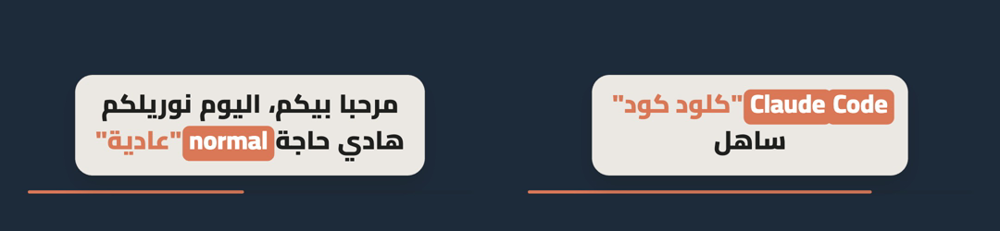
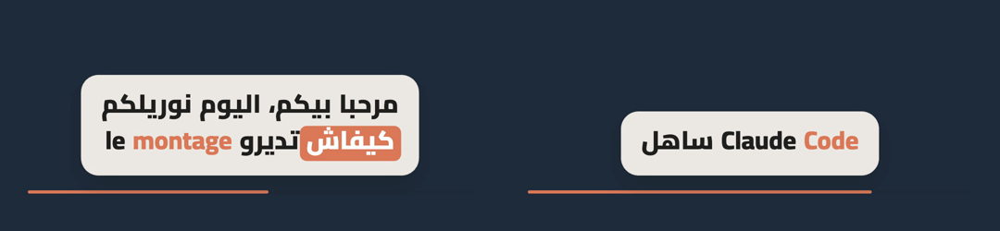
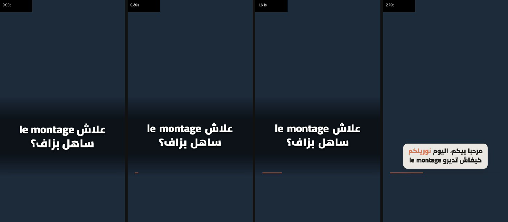
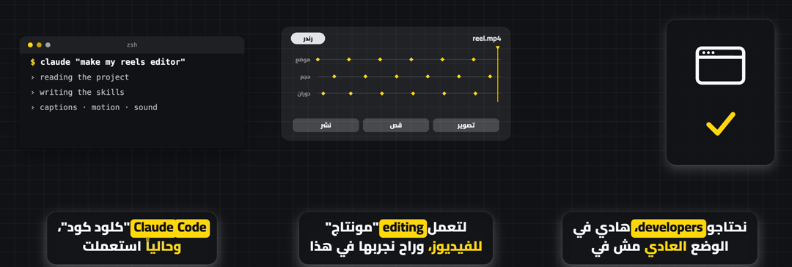
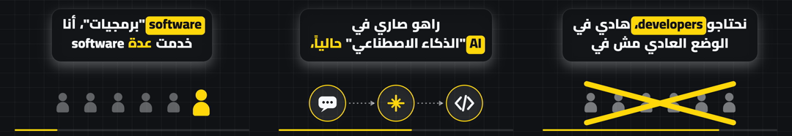
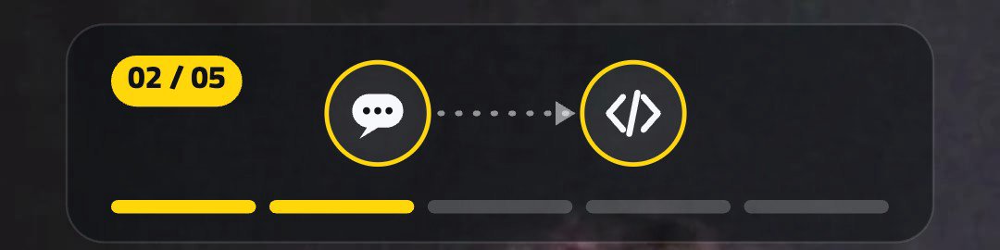

# wailzenz-video-dz 🇩🇿

**Algerian (Darija) video editing for Claude Code — free, and it runs on your own computer.**

Film yourself talking to the camera, hand the video to Claude, and get back a 9:16 reel ready for Instagram, TikTok and YouTube Shorts:
silences and mistakes cut, word-by-word Arabic captions, motion graphics, sound effects and a cover.

[العربية](README.md) · [Français](README.fr.md)



## What it does

| | |
|---|---|
| ✂️ **Careful cutting** | Cuts only real pauses, never inside a word; on a restart it keeps your second take |
| 🗣️ **Darija transcription** | Whisper large-v3 on the Mac GPU, or an Algerian-trained model (Hadra) — compare both on your voice and keep the better one |
| 💬 **Word-by-word Arabic captions** | Joined letters, right-to-left layout, the word you're saying lights up |
| 🇫🇷🇬🇧 **French & English terms** | Kept in Latin letters, followed by an Arabic gloss in quotes: «هادي حاجة normal "عادية"» |
| 🪝 **On-screen hook** | A strong line in the first two seconds, checked to be Algerian Darija (not Gulf words like «شلون» or «وايد») |
| 🎬 **Motion graphics** | 100 ready-made moves, text passing behind your head, maps, counters, cards… |
| 🔀 **Alternating split screens** | Animation on top with your face below, then your face on top with the animation below — the layout keeps changing |
| 🪟 **Overlay bands** | Not always 50/50: a slim band on top or at the bottom over your full-screen video, on a see-through card or straight on the picture |
| 🧠 **Visuals, not a second caption** | Panels never repeat the words in the caption: icons, UI mockups (terminal, timeline), comparison boards |
| 🔊 **Audio** | Voice cleanup, royalty-free sound effects, loudness to −14 LUFS |
| 🎙️ **Beyond reels** | Podcast → reels, beat-synced montages, motion explainers with no filming, covers/thumbnails |

Everything runs **locally**: your footage never leaves your machine.

## Requirements

- **Claude Code** (needs a Claude subscription — the plugin is free, Claude isn't).
- **A Mac**, ideally Apple Silicon (M1 or newer), 8 GB RAM minimum (16 GB is comfortable), 10 GB free disk.
- **Google Chrome** (the caption engine renders with it).
- Windows / Linux: works with the portable transcription engine (`--engine whisper`); the full experience is Mac-first. See [docs/INSTALL.md](docs/INSTALL.md).

## Install

In Claude Code:

```
/plugin marketplace add wailzenz/wailzenz-video-dz
/plugin install wailzenz-video-dz@wailzenz-video-dz
```

Then, once, ask Claude: **"set up the wailzenz-video-dz tools"** — or run it yourself:

```bash
bash ~/.claude/plugins/marketplaces/wailzenz-video-dz/setup/setup-mac.sh
```

It downloads about 4 GB (ffmpeg, Whisper, PyTorch…) into `~/.wailzenz-video-dz`. Details: [docs/INSTALL.md](docs/INSTALL.md).

## Use

Put your video in a folder and tell Claude, in Darija, English or French:

> «مونتيلي هاد الفيديو ودير منو ريل» · "edit this video into a reel" · « monte cette vidéo en reel »

Claude only asks about what matters (colours, logo, what to cut) and shows you preview frames before finishing.

| French/English terms stay in order | Darija hook card |
|---|---|
|  |  |

Split screens — animation on top, then at the bottom:





Or a slim band over the full-screen video, on a see-through card:



How it works, file formats and options: [docs/HOW-IT-WORKS.md](docs/HOW-IT-WORKS.md).

## Credits

Built on **[majed-video](https://github.com/majedphotos/video-ad-editor)** by **Majed Alzaabi** (MIT) — the engine, the motion moves and the whole editing method are his work; thank you.
This plugin adds the Algerian layer (Darija transcription, Algerian hook rules, Arabic glosses for Latin-script terms, French/English word order in captions) and a house style: alternating split screens and overlay bands, panels that never duplicate the caption, and careful cutting. Full list: [THIRD_PARTY_NOTICES.md](THIRD_PARTY_NOTICES.md). Changes: [CHANGELOG.md](CHANGELOG.md).

## Contributing

Found a Darija word spelled wrong, or a region that says it differently? Open an issue or a pull request — see [CONTRIBUTING.md](CONTRIBUTING.md).

## License

[MIT](LICENSE). Keep the original authors' notices when you share it.
